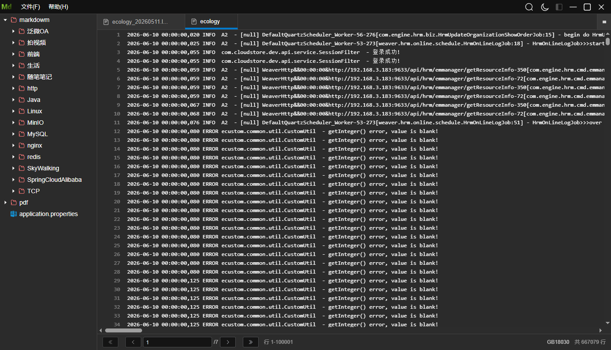

# MdViewer

## 项目介绍
MdViewer 是一款基于 **Tauri** 跨平台框架开发的本地 Markdown 笔记应用。它利用 Rust 和 Web 技术（Vue 3）构建，提供了一个轻量、安全且高效的笔记编写与管理环境，支持多种操作系统和语言。

## 软件架构
- **后端核心**：Rust + Tauri (提供系统级性能与原生交互能力)
- **前端框架**：Vue 3 (构建响应式用户界面)
- **UI 组件库**：Element Plus (提供专业美观的组件)
- **编辑器核心**：v-md-editor / TinyMCE (支持 Markdown 编辑与富文本扩展)

## 环境准备
在开始之前，请确保开发环境已安装以下组件：
- Node.js (推荐 LTS 版本)
- Rust 及 Cargo 包管理器
- Tauri CLI (可通过 `cargo install tauri-cli` 安装)

## 使用说明

### 1. 安装依赖
在项目根目录执行以下命令安装前端依赖：
```bash
yarn install
```

### 2. 启动调试
启动开发服务器并在独立窗口中运行应用：
```bash
yarn tauri dev
```

### 3. 运行前端预览
如只需查看前端界面（无 Tauri 后端功能）：
```bash
yarn run serve
```

### 4. 编译打包
构建生产环境的应用程序包：
```bash
yarn tauri build
```

## 打包与配置

### 目标平台
项目配置支持生成以下格式的安装包：
- **.deb**：适用于 Debian/Ubuntu 等 Linux 系统
- **.msi**：适用于 Windows 系统

### 多语言支持
应用界面已集成以下语言包：
- 简体中文 (zh-CN)
- 美式英文 (en-US)
- 巴西葡萄牙语 (pt-BR)
- 法语 (fr-FR)

## 资源声明
- **图标来源**：应用图标出自 [Flaticon](https://www.flaticon.com/free-icon/substance_9814620)，遵循其许可协议使用。
- **网络优化**：如遇 GitHub 下载缓慢，可通过 [清华镜像源](https://cloud.tsinghua.edu.cn/d/df482a15afb64dfeaff8/?p=/&mode=list) 进行加速。

## 应用截图
