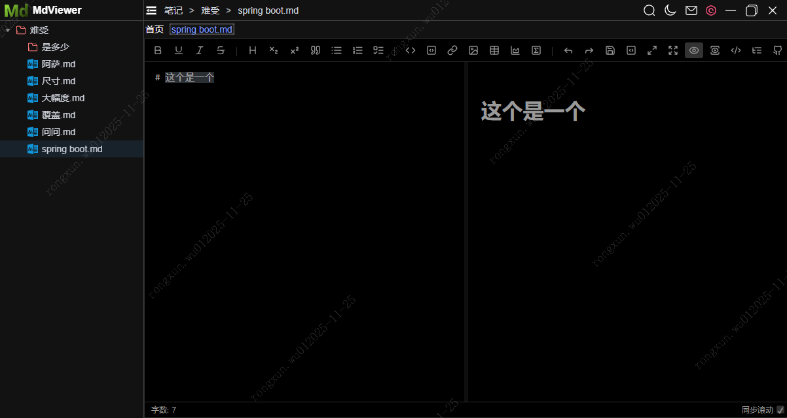

# MdViewer

### 项目介绍

基于tauri跨平台桌面应用框架的Markdown本地笔记软件

### 软件架构

rust、tauri、vue3、element-plus、v-md-editor

### 使用说明

1.  yarn build 编译前端项目
2.  yarn tauri dev 启动调试
3.  yarn tauri build 打包
4.  yarn run serve 运行前端项目

### github 加速

https://cloud.tsinghua.edu.cn/d/df482a15afb64dfeaff8/?p=/&mode=list

### 许可声明

应用图标出处：https://www.flaticon.com/free-icon/substance_9814620

### 打包类型

"targets": ["deb","msi"]

### 打包语言配置：

"language": ["zh-CN","en-US", "pt-BR", "fr-FR"]

### 应用截图

