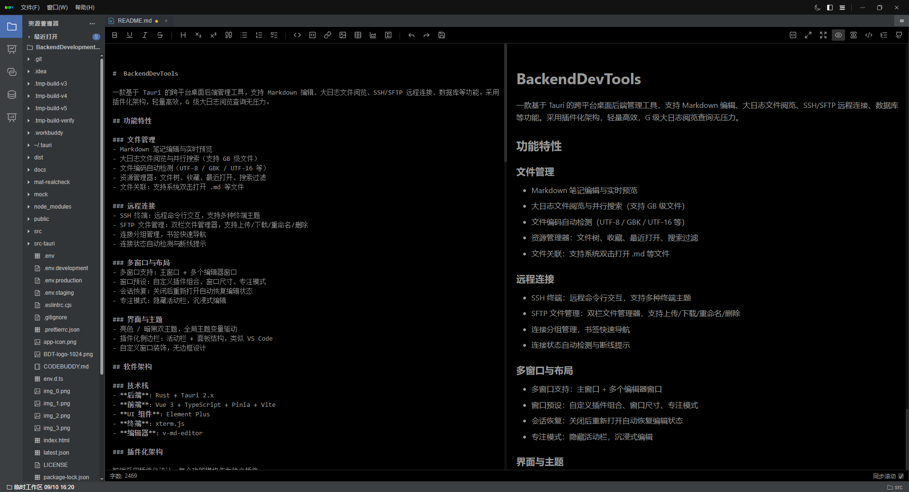
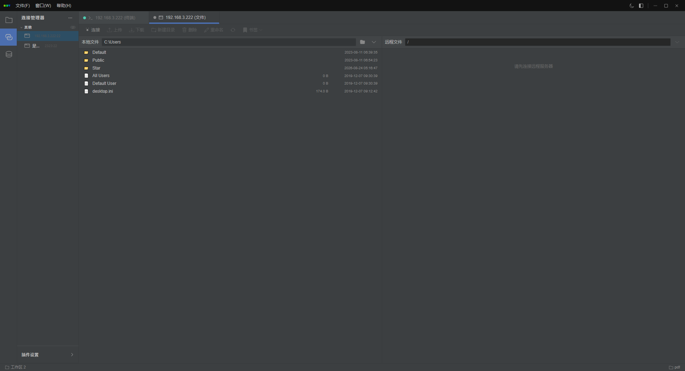
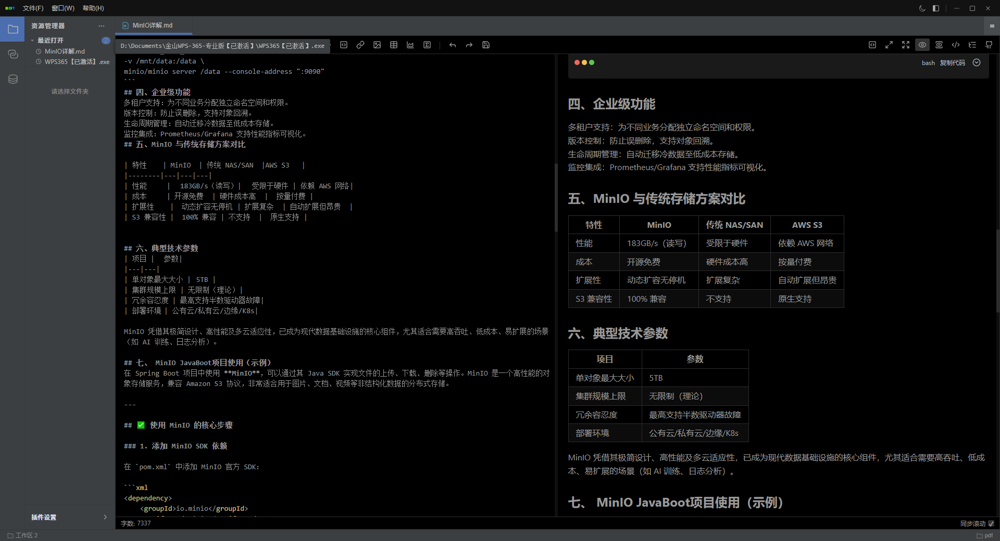
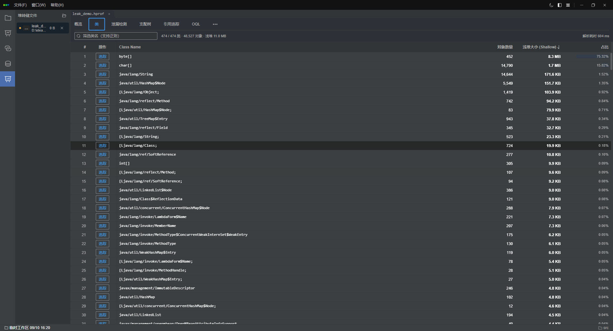

#  BackendDevTools

一款基于 Tauri 的跨平台桌面后端管理工具，支持 Markdown 编辑、大日志文件阅览、SSH/SFTP 远程连接、数据库等功能。采用插件化架构，轻量高效，G 级大日志阅览查询无压力。

## 功能特性

### 文件管理
- Markdown 笔记编辑与实时预览
- 大日志文件阅览与并行搜索（支持 GB 级文件）
- 文件编码自动检测（UTF-8 / GBK / UTF-16 等）
- 资源管理器：文件树、收藏、最近打开、搜索过滤
- 文件关联：支持系统双击打开 .md 等文件

### 远程连接
- SSH 终端：远程命令行交互，支持多种终端主题
- SFTP 文件管理：双栏文件管理器，支持上传/下载/重命名/删除
- 连接分组管理，书签快速导航
- 连接状态自动检测与断线提示

### 多窗口与布局
- 多窗口支持：主窗口 + 多个编辑器窗口
- 窗口预设：自定义插件组合、窗口尺寸、专注模式
- 会话恢复：关闭后重新打开自动恢复编辑状态
- 专注模式：隐藏活动栏，沉浸式编辑

### 界面与主题
- 亮色 / 暗黑双主题，全局主题变量驱动
- 插件化侧边栏：活动栏 + 面板结构，类似 VS Code
- 自定义窗口装饰，无边框设计

## 软件架构

### 技术栈
- **后端**：Rust + Tauri 2.x
- **前端**：Vue 3 + TypeScript + Pinia + Vite
- **UI 组件**：Element Plus
- **终端**：xterm.js
- **编辑器**：v-md-editor

### 插件化架构

前端采用插件化设计，每个功能模块作为独立插件：

```
src/plugins/
── files/          # 文件管理插件（资源管理器 + Markdown 编辑）
├── ssh/            # 远程连接插件（SSH 终端 + SFTP 文件管理）
── index.ts        # 插件注册入口
```

每个插件包含：
- **侧边栏面板**（SidebarPanel）：活动栏图标 + 侧边内容
- **主内容面板**（MainPanel）：编辑器/终端等主工作区
- **标签栏**（TabBar）：标签页渲染

通过 `pluginManager` 统一管理插件的注册、加载与切换，支持窗口级别的插件过滤（不同窗口启用不同插件组合）。

### 窗口管理

```
src-tauri/src/
├── window_manager/   # 窗口注册表、创建、聚焦、关闭
├── session/          # 会话快照保存与恢复
── workspace/        # 工作区管理
── command/          # Tauri 命令（文件操作、SSH/SFTP、日志搜索等）
├── sqlite/           # SQLite 数据库（SSH 连接配置存储）
── app/              # 应用初始化、托盘、自动启动
```

## 项目规划

### 数据库插件（计划中）

计划新增 **数据库插件**，扩展远程管理能力：

- **数据库连接管理**：支持 MySQL、PostgreSQL、SQLite 等主流数据库
- **SQL 编辑器**：语法高亮、自动补全、执行计划查看
- **数据浏览**：表结构查看、数据网格编辑、分页查询
- **连接复用**：集成到现有远程连接体系，支持连接分组与书签
- **插件化集成**：作为独立插件注册，可与其他插件共存于同一窗口


## 使用说明

### 开发环境

```bash
# 安装依赖
pnpm install

# 启动开发（前端热更新 + Tauri 调试）
pnpm tauri dev

# 仅启动前端开发服务
pnpm dev

# 类型检查
pnpm type-check

# 代码格式化
pnpm format
```

### 打包发布

```bash
# 完整构建（含类型检查）
pnpm build

# 打包 Tauri 应用（生成 deb/msi）
pnpm tauri build
```

### 打包配置

- 目标格式：`deb`、`msi`
- 支持语言：`zh-CN`、`en-US`、`pt-BR`、`fr-FR`

## 许可声明

应用图标出处：https://www.flaticon.com/free-icon/substance_9814620

## 应用截图




