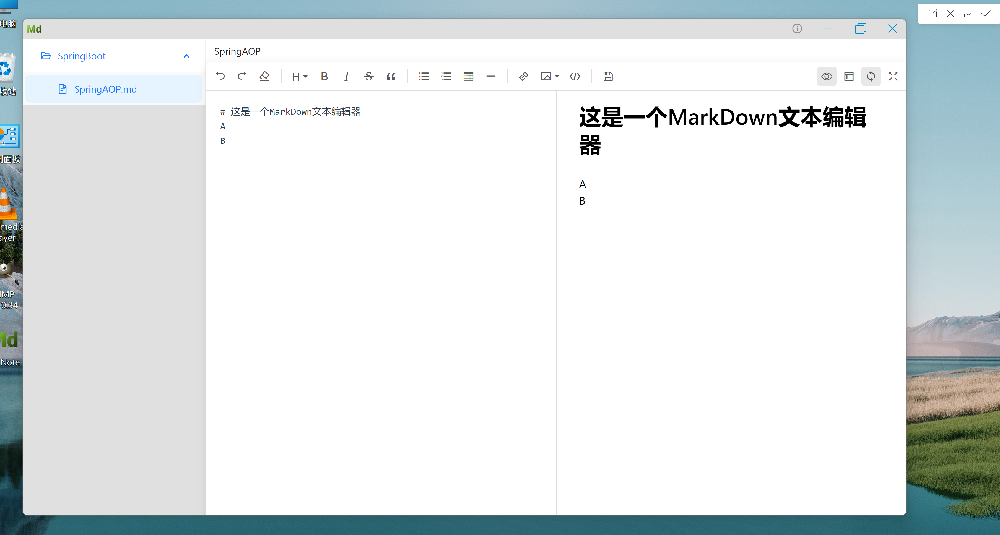

# md-note

### 项目介绍
`md-note` 是一个基于 Tauri 框架开发的跨平台 Markdown 本地笔记软件，支持多种操作系统，提供简洁高效的笔记编辑与管理功能。

### 软件架构
本项目采用以下核心技术栈：
- **Rust**：用于后端逻辑开发。
- **Tauri**：跨平台桌面应用框架。
- **Vue 3**：前端框架。
- **Ant Design Vue**：UI 组件库。
- **v-md-editor**：Markdown 编辑器。

### 使用说明
1. 编译前端项目：
   ```bash
   yarn build
   ```
2. 启动调试模式：
   ```bash
   yarn tauri dev
   ```
3. 打包应用程序：
   ```bash
   yarn tauri build
   ```
4. 运行前端项目：
   ```bash
   yarn run serve
   ```

### 许可声明
- 应用图标来源：[Flaticon](https://www.flaticon.com/free-icon/substance_9814620)

### 打包类型
支持以下打包格式：
- `deb`（适用于 Linux）
- `msi`（适用于 Windows）

### 多语言支持
本应用支持以下语言：
- 中文 (`zh-CN`)
- 英文 (`en-US`)
- 葡萄牙语 (`pt-BR`)
- 法语 (`fr-FR`)

### 应用截图


### 请我喝杯咖啡
如果您认为本仓库内容对您有价值，可以在此处对我打赏。此项并非必须，但其对我的鼓励将得以让本仓库获得持续更新。
